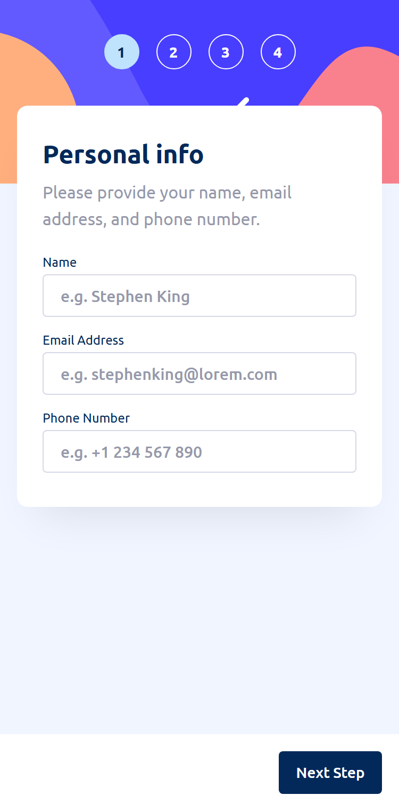
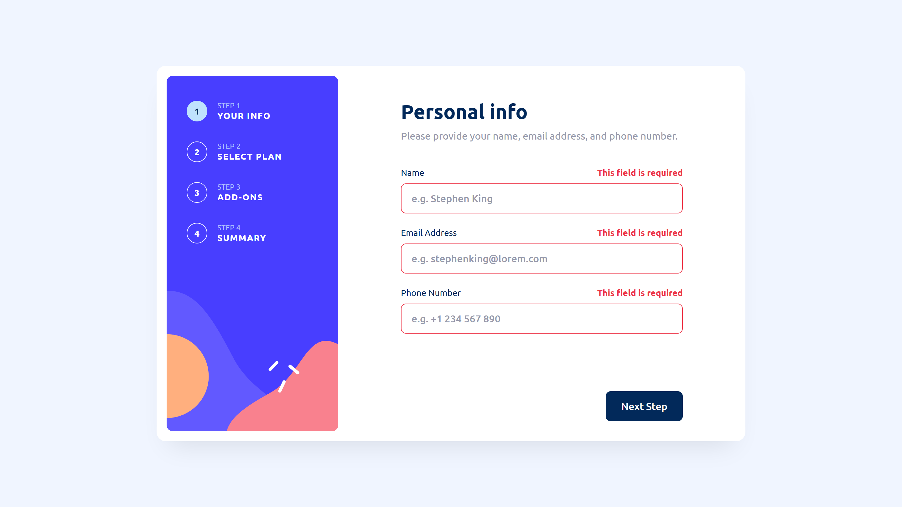
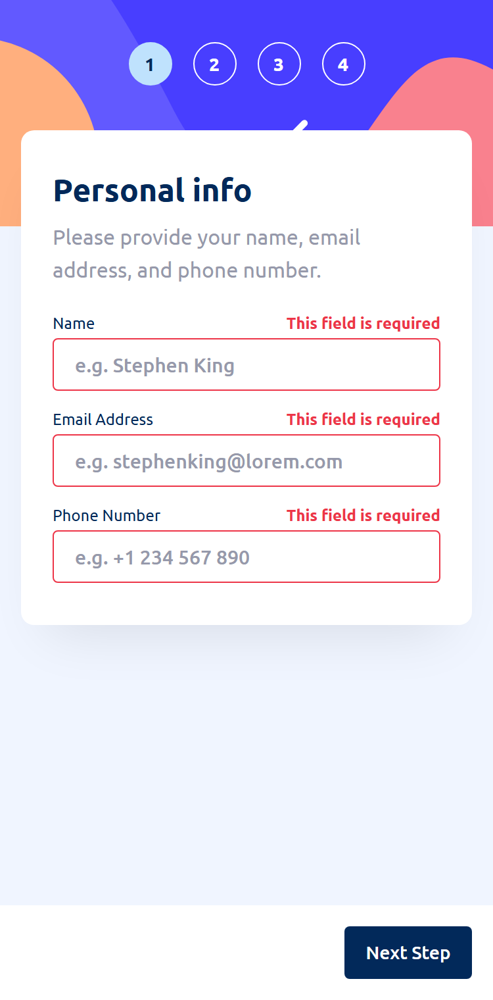
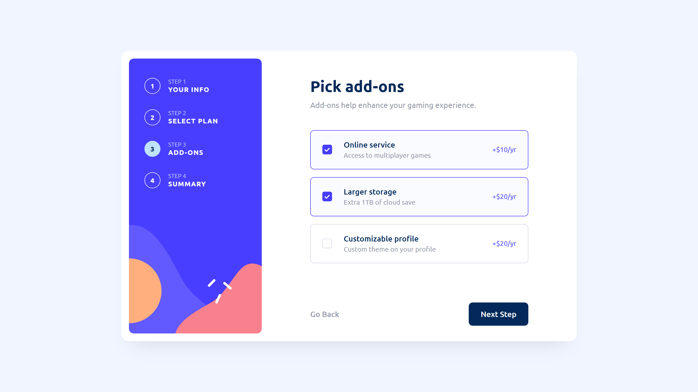
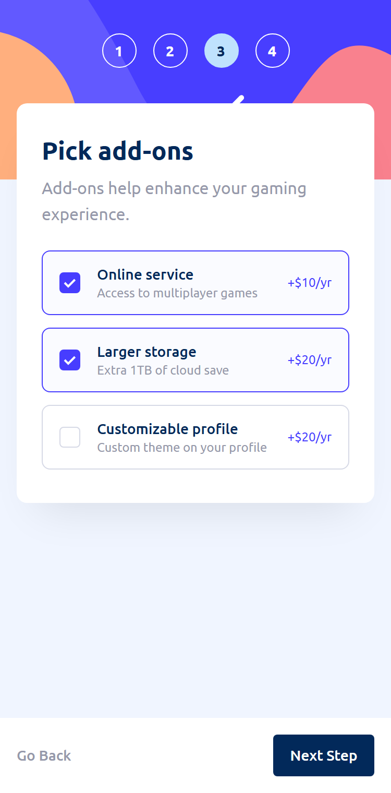
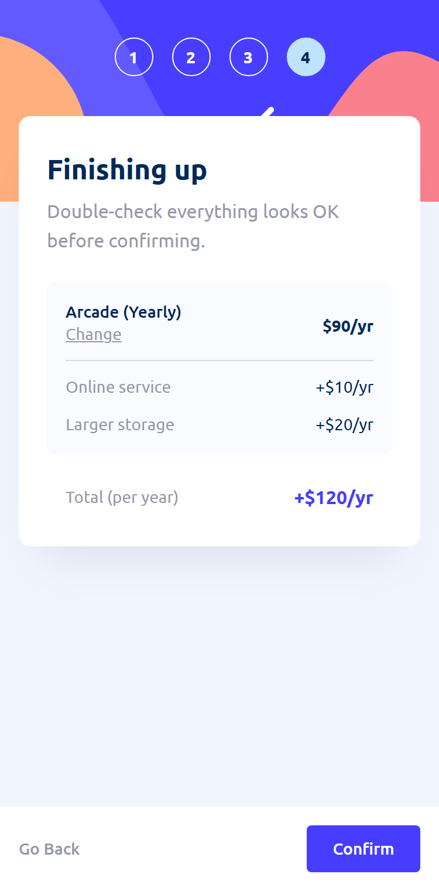
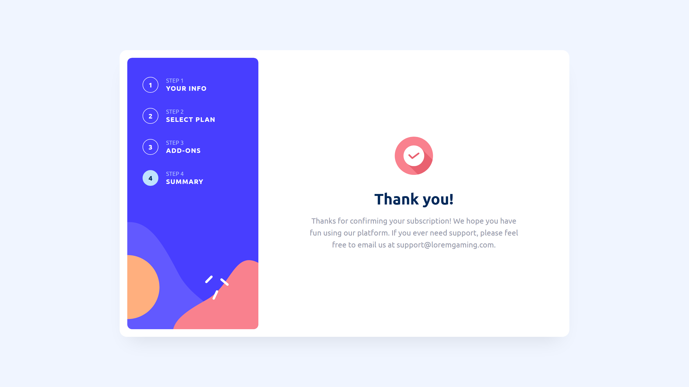
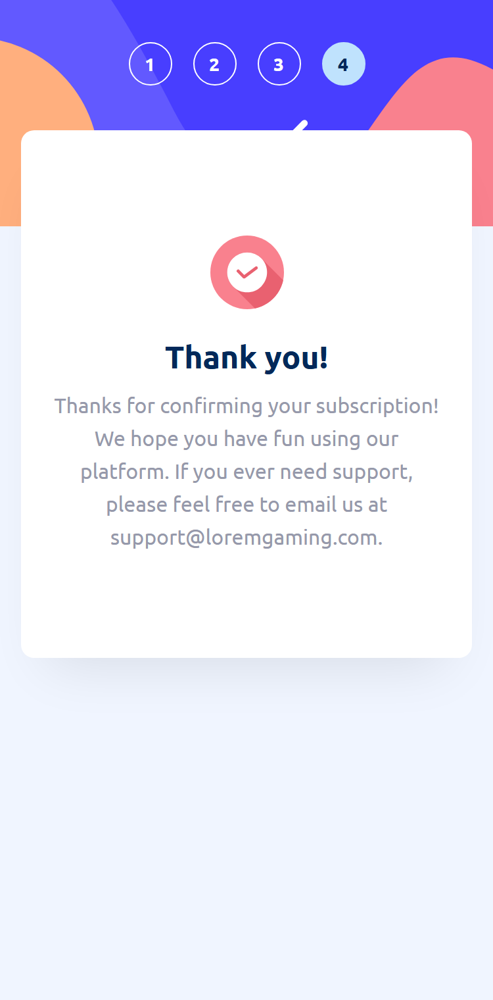

<div align="center">

# Multi-Step Subscription Form

A responsive, accessible, four-step subscription form built with semantic HTML, Sass and vanilla JavaScript.
It's a solution to the [Frontend Mentor multi-step form challenge](https://www.frontendmentor.io/challenges/multistep-form-YVAnSdqQBJ).


</div>

---

## Table of contents

- [Overview](#overview)
- [Features](#features)
- [Screenshots](#screenshots)
- [Getting started](#getting-started)
- [Project structure](#project-structure)
- [How it works](#how-it-works)
  - [State and navigation](#state-and-navigation)
  - [Pricing model](#pricing-model)
  - [Validation rules](#validation-rules)
  - [Responsive layout](#responsive-layout)
  - [Styling architecture](#styling-architecture)
  - [Accessibility](#accessibility)
- [Design decisions](#design-decisions)
- [Testing](#testing)
- [Known limitations and roadmap](#known-limitations-and-roadmap)
- [Acknowledgments](#acknowledgments)
- [Author](#author)

---

## Overview

Users sign up for a gaming subscription in four steps:

| Step | Purpose |
| --- | --- |
| **1. Your info** | Collects name, email address and phone number, with inline validation. |
| **2. Select plan** | Offers Arcade, Advanced or Pro on monthly or yearly billing. |
| **3. Add-ons** | Lets the user add optional extras: online service, larger storage and a customizable profile. |
| **4. Summary** | Shows the plan, add-ons and calculated total, with a shortcut back to change the plan. |
| **Confirmation** | Shows a thank-you screen after the order is confirmed. |

The whole app is one static `index.html` file with no dependencies to install and no build step.

## Features

- **Step-by-step navigation:** users can move forward and back freely, and every selection is kept.
- **Monthly/yearly billing toggle:** all prices, the "2 months free" badges and the summary total update together.
- **Live order summary:** it's calculated from the current selections, with a **Change** link back to plan selection.
- **Form validation** covers all three cases the challenge requires:
  - a required field is left empty,
  - the email address is badly formatted,
  - a step is submitted without a plan selected.
- **Responsive layout:** a card with a sidebar on desktop, and a stacked layout with a pinned action bar on mobile.
- **Hover and focus states** on every interactive element, with visible outlines for keyboard focus.
- **Accessible by default:** native form controls, a correctly announced on/off switch, error messages that are read out, and focus moved to each new step.
- **Self-hosted Ubuntu font** (400, 500 and 700 weights), so there are no requests to third-party font services.

## Screenshots

<table>
  <tr>
    <th>Desktop</th>
    <th>Mobile</th>
  </tr>
  <tr>
    <td></td>
    <td></td>
  </tr>
  <tr>
    <td></td>
    <td></td>
  </tr>
  <tr>
    <td></td>
    <td></td>
  </tr>
  <tr>
    <td></td>
    <td></td>
  </tr>
  <tr>
    <td></td>
    <td></td>
  </tr>
</table>

## Getting started

### Just viewing it

The compiled stylesheet (`css/style.css`) is committed, so you can clone the repository and open `index.html` in any modern browser. There's nothing to install and no network access needed.

```bash
git clone https://github.com/AlexisG1993/multi-step-form.git
cd multi-step-form
```

### Working on the styles

To edit the Sass, you need [Node.js](https://nodejs.org/) 18 or later.

```bash
npm install        # installs Dart Sass
npm run watch      # recompiles css/style.css whenever a file in scss/ changes
npm run build      # one-off, minified production build
```

To serve the page over HTTP while you work, use `npx serve .` or `python -m http.server 8000`.

### Deploy

The project is a static site, so it can be deployed as-is to GitHub Pages, Vercel or Netlify. Point the host at the repository root. Because `css/style.css` is committed, the host doesn't need a build command. Run `npm run build` before you push whenever you change the Sass.

## Project structure

```text
multi-step-form/
├── index.html              # Markup and application logic
├── scss/
│   ├── main.scss           # Entry point; @use-s every partial below in cascade order
│   ├── abstracts/          # Design tokens and mixins; these emit no CSS on their own
│   ├── base/               # @font-face, reset, body styles
│   ├── layout/             # App shell, form column and progress sidebar
│   └── components/         # Step headings, fields, plans, switch, add-ons, summary, buttons, thank-you
├── css/
│   └── style.css           # Compiled, minified output (generated by `npm run build`)
├── package.json            # Sass dependency and build/watch scripts
├── assets/
│   ├── fonts/              # Self-hosted Ubuntu (Regular, Medium, Bold)
│   └── images/             # Sidebar backgrounds, plan icons, checkmark, favicon
├── design/                 # Reference mockups from Frontend Mentor (desktop, mobile, active states)
├── docs/
│   └── screenshots/        # Screenshots used in this README
├── style-guide.md          # Colour palette and typography from the brief
├── preview.jpg             # Challenge preview image
└── AGENTS.md / CLAUDE.md   # AI-assistant guidance shipped with the challenge
```

## How it works

### State and navigation

All application state is a single object:

```js
const state = { step: 1, yearly: false };
```

The DOM is the source of truth for selections. The chosen plan is whichever radio button is checked, and the add-ons are whichever checkboxes are checked. This keeps the state object small and means the browser handles keyboard interaction and form semantics with no extra code.

- `showStep(n)` shows the matching `<section data-step>`, updates the progress indicator with `aria-current="step"`, swaps the primary button between **Next Step** and **Confirm**, and moves focus to the new step's heading.
- The form's `submit` event drives forward navigation. Validation runs first, and only steps 1 and 2 can block progress.
- `renderPrices()` and `renderSummary()` are pure render functions that read from `state` and the form controls, so switching billing period never needs extra bookkeeping.

### Pricing model

Prices are stored once as monthly values. Yearly prices are derived as **10 × the monthly price**, which matches the design's "2 months free" offer.

| Item | Monthly | Yearly |
| --- | ---: | ---: |
| Arcade | $9/mo | $90/yr |
| Advanced | $12/mo | $120/yr |
| Pro | $15/mo | $150/yr |
| Online service | +$1/mo | +$10/yr |
| Larger storage | +$2/mo | +$20/yr |
| Customizable profile | +$2/mo | +$20/yr |

### Validation rules

| Field | Rule | Message |
| --- | --- | --- |
| Name | Required | `This field is required` |
| Email | Required and must match `name@domain.tld` | `Invalid email address` |
| Phone | Required, at least 7 characters of digits, spaces, `()` or `-`, with an optional leading `+` | `Invalid phone number` |
| Plan | One option must be selected | `Please select a plan` |

Validation is designed not to nag:

- **On submit**, every field is checked and focus moves to the first invalid one.
- **On blur**, a field that has a value is re-checked, so a malformed email is caught as soon as the user leaves the field.
- **On input**, an existing error clears as soon as the value becomes valid. New errors never appear while the user is still typing.

The browser's built-in validation popups are turned off with `novalidate`, so the custom inline messages in the design are shown instead.

### Responsive layout

The layout is mobile-first, with a single breakpoint at 768px, applied through the `md` mixin.

| | Mobile (< 768px) | Desktop (≥ 768px) |
| --- | --- | --- |
| Progress | Numbered circles over a background illustration | Vertical sidebar with step labels |
| Content | Floating card that overlaps the header | Fixed 450px column inside a 940px card |
| Plans | Stacked rows, icon beside text | Three columns, icon above text |
| Actions | White bar pinned to the bottom of the viewport | Inline at the bottom of the card |

Both layouts come from the **same DOM**; only the media-query styles change. There are no duplicated components and no JavaScript layout switching.

### Styling architecture

The styles are written in **Sass (SCSS syntax)** with the module system (`@use`, not the deprecated `@import`), and organised in a simplified 7-1 pattern.

**Design tokens.** The colours, type scale, radii and breakpoint from `style-guide.md` live in one place, `abstracts/_tokens.scss`, and are read through small helper functions. An unknown colour name fails the build instead of quietly compiling to nothing:

```scss
.plan__price {
  @include text('sm');          // font-size 14px, line-height 20px from the type scale
  color: color('grey-500');     // @error at compile time if the token doesn't exist
}
```

**Mixins encode behaviour, not just values:**

| Mixin | Purpose |
| --- | --- |
| `md` | Mobile-first breakpoint. Everything outside it is the mobile layout. |
| `text($size)` | Applies a font-size/line-height pair from the type scale. |
| `focus-ring` | The one keyboard focus style used by every control. |
| `selectable` / `selected` | Shared border, hover and selected states for plan cards and add-on rows. |
| `button-reset` | Strips native button styling for text-style buttons. |

**Naming** follows BEM (`.plan__card`, `.btn--confirm`), with `is-*` classes for state that JavaScript toggles. Where the state is already in the DOM, CSS reads it directly instead of JavaScript copying it into classes:

| State | Selector |
| --- | --- |
| Selected plan | `.plan__input:checked + .plan__card` |
| Selected add-on | `.addon:has(:checked)` |
| Billing toggle position | `.switch[aria-checked='true'] .switch__knob` |
| Current step | `.progress__number[aria-current='step']` |
| Field error | `.field__input[aria-invalid='true']` |

As a result, the JavaScript only sets semantic attributes and never touches presentation classes beyond `btn--confirm` and `is-active`.

**Output.** The compiled `css/style.css` is about 11 KB minified, with no runtime dependencies. The page also honours `prefers-reduced-motion`.

### Accessibility

- **Native controls everywhere:** plans are radio buttons, add-ons are checkboxes and navigation uses buttons, each visually restyled. Keyboard support (Tab, arrow keys, Space) comes from the browser.
- **The billing toggle** is a `<button role="switch">` with `aria-checked`, so screen readers announce it as an on/off switch.
- **Errors are linked to their fields** with `aria-describedby`, flagged with `aria-invalid`, and announced through `aria-live="polite"` regions.
- **Focus moves on every step change** to the new heading (`tabindex="-1"`), so screen-reader and keyboard users are told what changed.
- **Progress is exposed** through a labelled `<nav>` containing an ordered list, with `aria-current="step"` on the active step.
- **Decorative images** use empty `alt` attributes, and grouped controls sit inside `<fieldset>` elements with visually hidden legends.

## Design decisions

The layout matches the reference mockups to within 2px (see [Testing](#testing)). In a few places the implementation intentionally differs from them:

| Decision | Reasoning |
| --- | --- |
| **No plan is pre-selected** | The mockups show Arcade selected, but the brief requires an error when "a step is submitted, but no selection has been made", which can only happen if nothing is selected to begin with. |
| **Summary shows "(Yearly)" on yearly billing** | One mobile mockup reads "Arcade (Monthly)" next to yearly prices, which looks like a design error. |
| **Total always has a `+` prefix** | The desktop mockup uses "+$12/mo" and the mobile one "$120/yr". The desktop version was used for both. |
| **The confirmation screen keeps step 4 highlighted** | Matches the mockups. The thank-you screen isn't a separate numbered step. |

## Testing

### Visual accuracy

Each design in `design/` was compared against the live page **pixel by pixel**, rather than by eye:

1. Headless Chrome ([Puppeteer](https://pptr.dev/)) drives the form into the exact state shown in each mockup, at the mockup's exact size: 1440×810 for desktop, and 375×667, 375×695 or 375×761 for mobile.
2. [pixelmatch](https://github.com/mapbox/pixelmatch) diffs the render against the JPG, and a 50/50 overlay of the two is saved. Any misalignment shows up as ghosting.
3. An **edge profile** scans a single pixel column of both images and lists the y-coordinates of every sharp colour change: card borders, input borders and text baselines. Comparing these lists gives exact pixel offsets instead of guesses.

That process found and fixed offsets of 3–7px that weren't visible side by side, such as description paragraphs, plan-card heights, input pitch on mobile and the summary divider. **Every measured edge now sits within 0–2px of the design.**

| Design | Mismatch before | Mismatch after |
| --- | ---: | ---: |
| Desktop: step 1 | 0.74% | 0.49% |
| Desktop: step 2 (monthly / yearly) | 0.83% / 0.91% | 0.60% / 0.72% |
| Desktop: step 3 | 1.23% | 0.71% |
| Desktop: step 4 | 0.61% | 0.48% |
| Desktop: step 5 | 0.58% | 0.24% |
| Mobile: step 1 | 2.28% | 1.19% |
| Mobile: step 2 (monthly / yearly) | 2.69% / 2.37% | 1.34% / 1.65% |
| Mobile: step 3 | 3.28% | 1.86% |
| Mobile: step 4 | 1.51% | 1.13% |
| Mobile: step 5 | 1.63% | 0.47% |

The remaining mismatch is almost entirely **glyph anti-aliasing**. The mockups weren't rendered by Chrome's text engine, so the edges of every letter differ slightly even where the text sits on exactly the same pixels.

The move from Tailwind to Sass was verified the same way. The Sass build rendered **pixel-identical** to the previous Tailwind build on every step, apart from sub-pixel anti-aliasing on the circle borders.

### Functional checklist

- [x] Empty submit on step 1 shows an error on all three fields
- [x] A malformed email shows `Invalid email address`
- [x] Continuing from step 2 with no plan shows `Please select a plan`
- [x] Switching between monthly and yearly updates plan prices, add-on prices and the summary
- [x] **Go Back** and **Change** keep all selections
- [x] The form can be completed with the keyboard only
- [x] Hover and focus states appear on inputs, cards, checkboxes, the toggle and buttons
- [x] Layouts hold from 320px up to wide desktop screens

## Known limitations and roadmap

- **Nothing is submitted.** Confirming shows the thank-you screen but doesn't send data anywhere. A real version would post to an API and handle loading and error states.
- **Progress doesn't persist.** Reloading the page resets the form. Saving to `sessionStorage` would let users resume where they left off.
- **Automated tests:** the Puppeteer walkthrough and pixel-diff scripts could become committed Playwright visual-regression tests, run in CI with an accessibility check such as axe-core.

## Acknowledgments

- Challenge, design and assets by [Frontend Mentor](https://www.frontendmentor.io).
- Typeface: [Ubuntu](https://fonts.google.com/specimen/Ubuntu) by Dalton Maag.

## Author

- GitHub: [@AlexisG1993](https://github.com/AlexisG1993)
